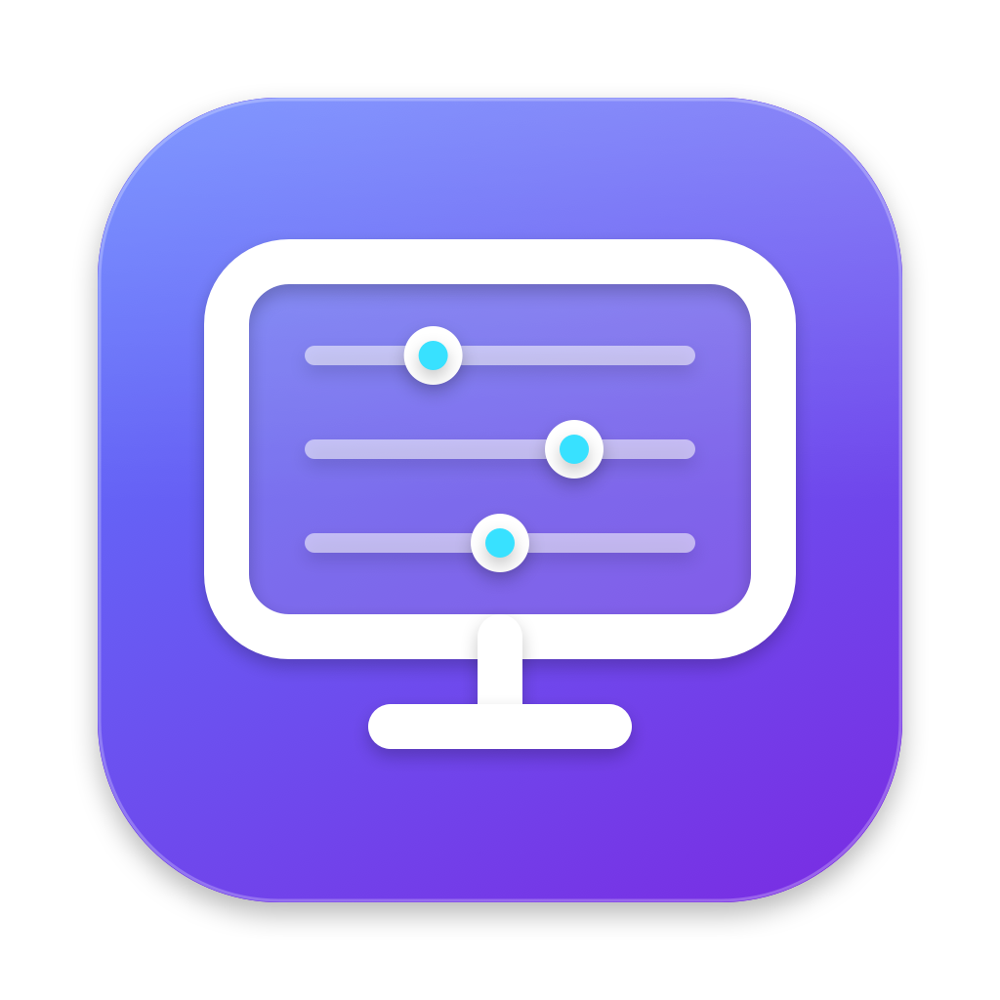

<p align="center">
  
</p>

# VibeScreen

**Your TV controls, desktop automation, and system overview — within reach on your Mac.**

VibeScreen is a native macOS rewrite of ColorControl's non-GPU workflows. It brings LG webOS and Samsung Tizen control, presets, Wake-on-LAN, and desktop automation into a SwiftUI/AppKit app with quick menu-bar access.

The native executable is currently named **VibeScreen**. VibeScreen is the repository name.


## One place for the controls you reach for

- **TV control from your desktop.** LG pairing and device controls, pointer remote, volume, inputs, apps, and typed picture-setting commands; Samsung transport and remote-command support.
- **Quick menu-bar access.** LG sliders, refresh, open-window actions, and a configurable global TV power shortcut.
- **Repeatable workflows.** Ordered presets, delays, retry/cancellation policies, and routing for startup, wake, sleep, and session events.
- **Desktop utilities.** Native application/game launching, display-mode controls, and ColorSync inventory/validation boundaries.
- **A native system overview.** CPU, memory, network rates, thermal pressure, and supported power/battery information.
- **A migration path.** Previewable legacy import with typed models and separate credential storage.

The macOS application uses SwiftUI and AppKit. NVIDIA/AMD driver controls belong to the retained Windows reference and are outside the native app's scope.

## Hardware support and current limits

| Area | Current evidence |
| --- | --- |
| Native macOS app | Development bundle builds; menu-bar/window lifecycle has recorded smoke checks |
| LG webOS | Pairing confirmed; individual settings and power workflows still need model/firmware checks |
| Samsung Tizen | Protocol/client implementation present; real-device acceptance remains |
| Displays and color profiles | Public-API adapters present; supported operations depend on hardware and need acceptance checks |
| Distribution | Developer ID signing, notarization, and a distribution archive remain release work |

This is a **development preview**. A control visible in the UI does not imply verified support on every TV. Read [current progress](migration/PROGRESS.md) and [known limitations](migration/docs/KNOWN_LIMITATIONS.md) before enabling automation.

## Build the native app

Requires **macOS 14+** and **Xcode with Swift 6 support**. Use the full Xcode toolchain.

```sh
git clone https://github.com/hiepkhach1005/VibeScreen.git
cd VibeScreen/macOS/VibeScreen
swift build
swift run VibeScreen
```

To run the core tests:

```sh
swift test
```

Production builds use **Keychain** for pairing credentials. The optional `Scripts/build-dev-app.sh` creates an ad-hoc development bundle with an explicitly enabled plaintext credential-file mode; that mode is for local development and is documented in [build and release notes](migration/docs/BUILD_RELEASE.md).

## Find your way around

| Path | Contents |
| --- | --- |
| [`macOS/VibeScreen/`](macOS/VibeScreen/) | Native Swift app, core, platform adapters, and tests |
| [`migration/`](migration/) | Progress, decisions, feature maps, and acceptance evidence |
| [`legacy-windows/`](legacy-windows/) | Original ColorControl Windows source retained as the behavioral reference |

See the [native project README](macOS/VibeScreen/README.md), [architecture](migration/docs/ARCHITECTURE.md), and [feature parity matrix](migration/docs/FEATURE_PARITY_MATRIX.md). [Open an issue](https://github.com/hiepkhach1005/VibeScreen/issues) with your TV model, firmware, and steps to reproduce; omit pairing keys, tokens, and network identifiers.

## Credits and licensing

VibeScreen builds on [ColorControl by Maassoft](https://github.com/Maassoft/ColorControl). The original Windows code and copyright notices are retained. The upstream [GNU GPL v3 license](LICENSE.txt), [third-party notices](LICENSE-THIRD-PARTY.txt), and [Novideo sRGB notice](LICENSE-NOVIDEO.txt) are included; see [third-party attribution](THIRD_PARTY_NOTICES.md) for their scope and source.
